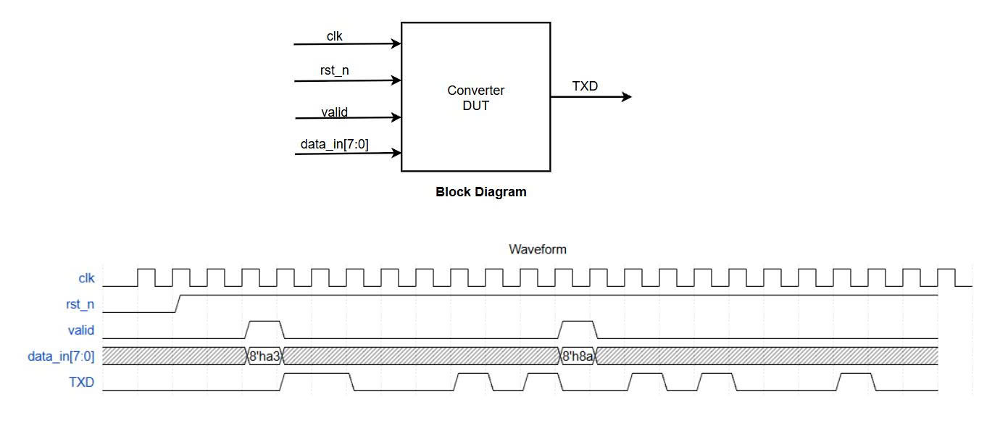
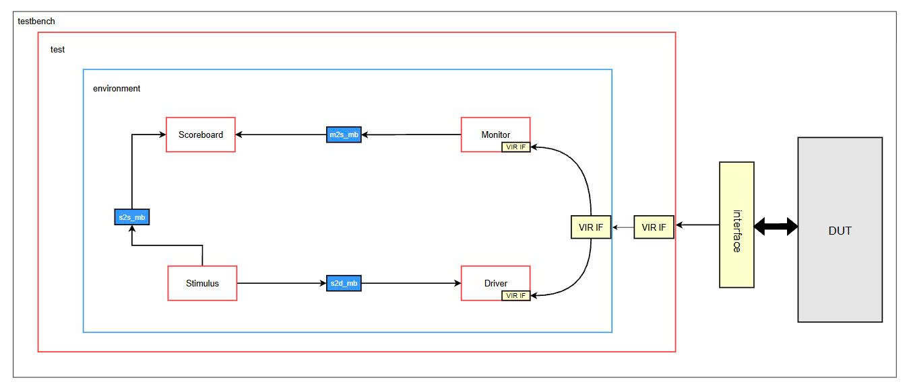

# Parallel-to-Serial (P2S) Converter: SystemVerilog Layered Testbench

## 📌 Project Overview
This repository contains a robust, **OOP-based SystemVerilog Layered Testbench** designed to verify an 8-bit Parallel-to-Serial (LSB-first) Converter. The verification environment is built from scratch utilizing advanced SystemVerilog features including Classes, Inheritance, Mailboxes, and Virtual Interfaces.

## ⚙️ Design Under Test (DUT)
The DUT is an 8-bit Parallel-to-Serial converter for serial communication.



* **Inputs:** `clk`, `rst_n` (active low), `valid`, `data_in[7:0]`
* **Output:** `TXD` (Serial data out, LSB first)
* **Inputs:** `clk`, `rst_n` (active low), `valid`, `data_in[7:0]`
* **Output:** `TXD` (Serial data out, LSB first)
* **Behavior:** When `valid` is triggered, the DUT captures the 8-bit `data_in` and shifts it out serially via the `TXD` pin on subsequent clock cycles.

## 🏗️ Testbench Architecture
The verification environment follows a standard Layered Testbench architecture, separating the dynamic transaction level from the static physical signal level.



* **Stimulus (Generator):** Generates random 8-bit data packets and sends them to the Driver (via `s2d_mb`) and Scoreboard (via `s2s_mb`).
* **Driver:** Receives packets from the Stimulus and drives the physical signals (`valid`, `data_in`) to the DUT through a **Virtual Interface**.
* **Monitor:** Passively samples the `TXD` output via the Virtual Interface, reconstructs the serial bits into an 8-bit transaction, and forwards it to the Scoreboard (via `m2s_mb`).
* **Scoreboard:** Acts as the checker. It compares the expected packet from the Stimulus against the actual packet collected by the Monitor.
* **Environment:** Encapsulates and connects all the components above using Mailboxes.
* **Testcases:** Implemented using **Inheritance**. A `base_test` is defined, which is extended by `single_convert_test` and `multi_convert_test` to run different scenarios.

## 📂 Directory Structure
```text
├── Design/
│   └── rtl/
│       └── parallel_to_serial.vp     # DUT source code (Protected/Encrypted IP)
├── Verification/
│   ├── sim/
│   │   ├── Makefile                  # Automation script for compilation and simulation
│   │   ├── compile.f                 # Top-level compilation file list
│   │   ├── rtl.f                     # Compilation file list for RTL sources
│   │   └── tb.f                      # Compilation file list for testbench sources
│   ├── tb/
│   │   ├── converter_pkg.sv          # Package containing all testbench environment classes
│   │   ├── driver.sv                 # Drives stimulus to DUT
│   │   ├── dut_interface.sv          # Interface bridging the dynamic testbench and static DUT
│   │   ├── environment.sv            # Wraps components & mailboxes
│   │   ├── monitor.sv                # Captures DUT output
│   │   ├── packet.sv                 # Transaction data class (defines randomized variables/payload)
│   │   ├── scoreboard.sv             # Data comparison
│   │   ├── stimulus.sv               # Transaction generator
│   │   └── testbench.sv              # Top module, instantiates DUT and Interfaces
│   └── testcase/
│       ├── base_test.sv              # Base test class
│       ├── multi_convert_test.sv     # Multiple transaction scenario
│       ├── single_convert_test.sv    # Single transaction scenario
│       └── test_pkg.sv               # Package containing all test scenarios
├── images/
│   ├── dut.jpg                       # DUT Block Diagram image
│   └── testbench.jpg                 # Testbench Architecture image
└── README.md                         # Project documentation
```
## 🛠️ How to Run Simulation (Compile-Once-Run-Many Flow)
This project utilizes an advanced Makefile flow combined with SystemVerilog `plusargs`. This allows compiling the entire testbench environment exactly once, and dynamically selecting different testcases during the runtime phase, significantly reducing simulation turnaround time.

**Prerequisite:** Siemens QuestaSim installed and added to your system path.

1. **Navigate to the simulation directory:**
   ```bash
   cd Verification/sim
   ```

2. **Step 1: Compile the Design and Testbench (Do this only once)**
   ```bash
   make build
   ```

3. **Step 2: Run a Specific Testcase**
   By default, running `make run` will execute the `single_convert_test`.
   ```bash
   make run
   ```
   To run a different testcase (e.g., `multi_convert_test`) without recompiling, pass the `TESTNAME` argument:
   ```bash
   make run TESTNAME=multi_convert_test
   ```

4. **Step 3: View Waveforms (Optional)**
   After running a simulation, you can open the waveform viewer:
   ```bash
   make wave 
   ```

5. **Clean generated files:**
   ```bash
   make clean
   ```
## 🖥️ Sample Simulation Output

### 1. Single Transaction Test (`single_convert_test`)
This test generates and verifies a single 8-bit transaction.

```log
# run -all
#100: [stimulus] Sent packet to driver
#100: [stimulus] Sent packet to scoreboard
#100: [driver] Get packet from stimulus
#131: [driver] Drive DUT with data in a3
#131: [monitor] Start capture data in TXD
#291: [monitor] Data capture is 8'ha3, sent to scoreboard
#291: [scoreboard] Data comparision is matching 8'ha3
# End of simulation
# ** Note: $finish    : ../tb/testbench.sv(42)
#    Time: 1 us  Iteration: 0  Instance: /testbench
```

### 2. Multiple Transaction Test (`multi_convert_test`)
This test dynamically extends the base test to generate and verify multiple back-to-back 8-bit transactions.

```log
# run -all
#100: [stimulus] Sent packet to driver
#100: [stimulus] Sent packet to scoreboard
#100: [stimulus] Sent packet to driver
#100: [stimulus] Sent packet to scoreboard
#100: [driver] Get packet from stimulus
#131: [driver] Drive DUT with data in a3
#131: [monitor] Start capture data in TXD
#270: [driver] Get packet from stimulus
#291: [monitor] Data capture is 8'ha3, sent to scoreboard
#291: [scoreboard] Data comparision is matching 8'ha3
#311: [driver] Drive DUT with data in 8a
#311: [monitor] Start capture data in TXD
#471: [monitor] Data capture is 8'h8a, sent to scoreboard
#471: [scoreboard] Data comparision is matching 8'h8a
# End of simulation
# ** Note: $finish    : ../tb/testbench.sv(42)
#    Time: 1 us  Iteration: 0  Instance: /testbench
```
